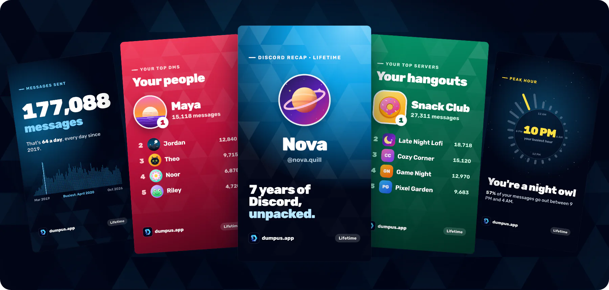
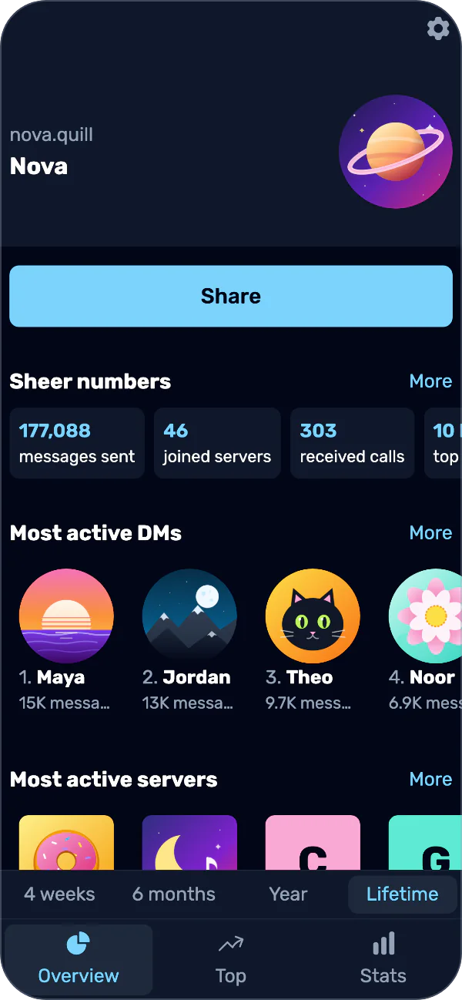
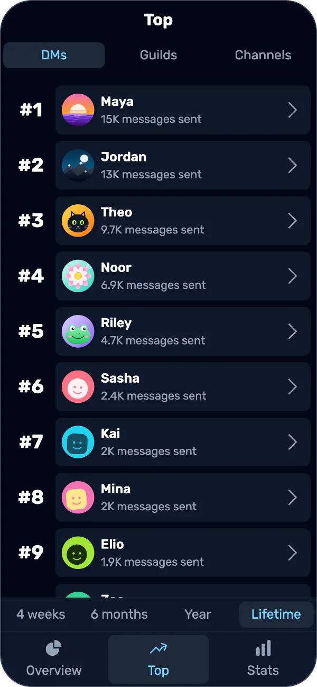
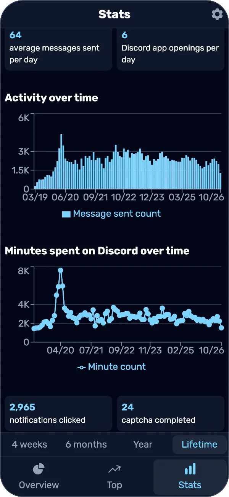
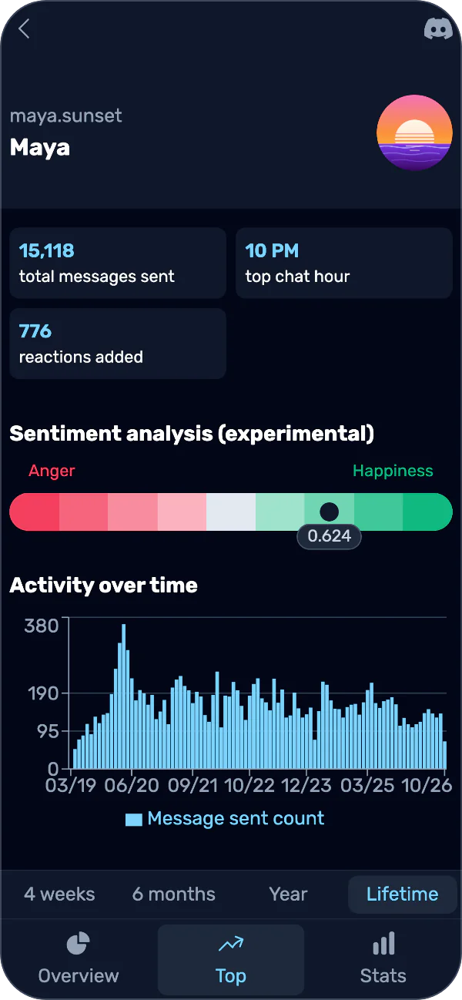

  

<h1 align="center">Dumpus</h1>

  <b>Stats for Discord.</b> Dumpus reads the data package Discord gives you, shows who you talk to, where you hang out and when you're online, and turns it into cards to share.

  
  
  

  Desktop builds for <a href="https://github.com/Androz2091/dumpus-app/releases/latest">Windows and macOS</a> · <a href="https://androz2091.fr/discord">Our Discord server</a>

## What you get

<table>
  <tr>
    <td align="center" width="25%"></td>
    <td align="center" width="25%"></td>
    <td align="center" width="25%"></td>
    <td align="center" width="25%"></td>
  </tr>
  <tr>
    <td align="center">Your numbers at a glance</td>
    <td align="center">Top DMs, servers and channels</td>
    <td align="center">Your activity over time</td>
    <td align="center">A page for each of them</td>
  </tr>
</table>

- Look at the last 4 weeks, 6 months, year, or your whole history.
- Share 8 story cards and a square summary, drawn on your device.
- Keep several packages and switch between them.

The screenshots and cards show a made-up account.

## Your data

- You paste the link from Discord's email. Our server downloads the package, turns it into a database with [`dumpus-processor`](processor), and deletes the zip.
- It stores that database encrypted with a key from your link, and deletes the link once processing starts, so what it keeps can't be read without your link. The app decrypts it on your device.
- **Delete current package** in the settings deletes it from your device and from our server. Encrypted copies are deleted after 90 days anyway.
- It's all open source, and you can [run your own server](api/README.md#self-hosting).

## Processing in Go

Packages are processed in Go: **3.7× faster** and **5× less memory** than with Python.

|                                  | Python | Go     |
| -------------------------------- | ------ | ------ |
| Typical package (median)         | 16.8 s | 4.4 s  |
| Large packages (90th percentile) | 48.4 s | 14.9 s |
| Peak memory (median)             | 277 MB | 51 MB  |
| Start-up                         | 0.27 s | 1.1 ms |

Tested on real packages, 2 CPUs, median of 3 runs per package.

## In this repo

| Folder                                                                         | What it is                                                                      |
| ------------------------------------------------------------------------------ | ------------------------------------------------------------------------------- |
| [`src/`](src), [`android/`](android), [`ios/`](ios), [`src-tauri/`](src-tauri) | The app, in Next.js, with Capacitor for Android and iOS and Tauri on desktop    |
| [`api/`](api)                                                                  | The API that queues packages and hands out their encrypted databases, in Python |
| [`processor/`](processor)                                                      | `dumpus-processor`, which turns a package into the app's database, in Go        |
| [`landing/`](landing)                                                          | [dumpus.app](https://dumpus.app), the website                                   |

## Contributing

- [CONTRIBUTING.md](CONTRIBUTING.md): how to send a change
- [DEVELOPERS.md](DEVELOPERS.md): run and build the app
- [TRANSLATING.md](TRANSLATING.md): translate it on Crowdin

Dumpus is the next version of the [Discord Data Package Explorer](https://ddpe.androz2091.fr), and is licensed under [GPL-3.0](LICENSE).
